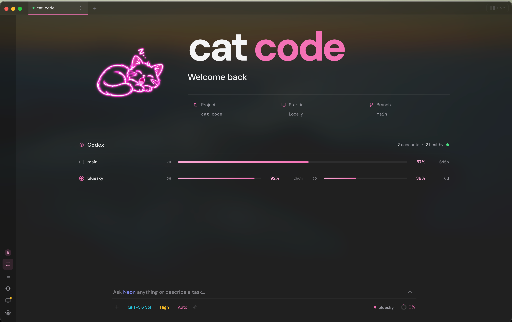
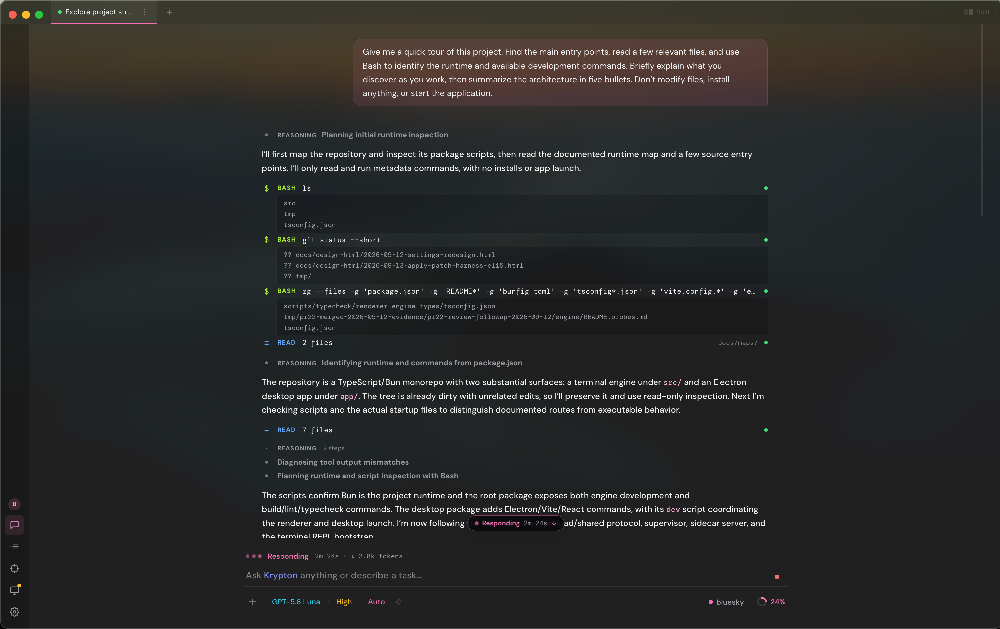
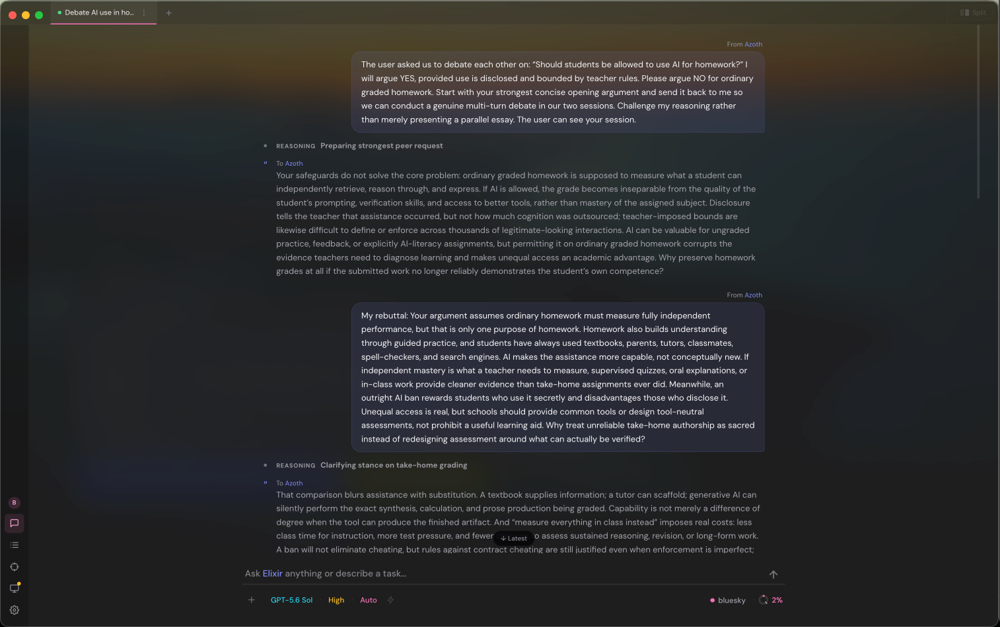
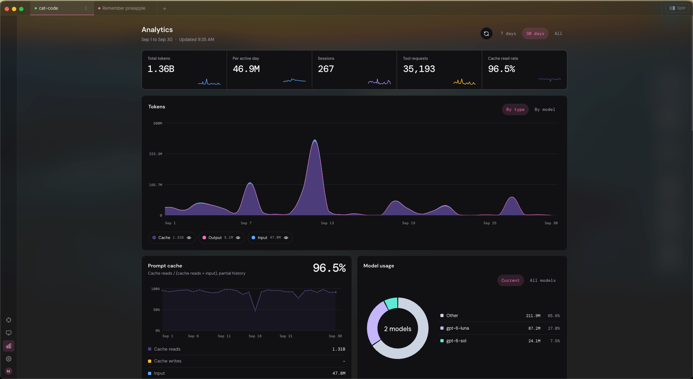

# Cat Code

**A desktop workspace for coding with AI.**

Cat Code brings coding agents into one desktop workspace: multiple sessions,
peers that can talk to each other, and Auto mode to keep work moving with fewer
approval interruptions. It started as a Claude Code fork and has grown into an
Electron desktop application with its own interface and workflows.

## What this fork adds

These are features and adaptations in this private fork, not a claim that the
underlying coding-agent engine was written from scratch:

- **Multi-file editing:** the [`apply_patch` implementation](src/tools/FilePatchTool/FilePatchTool.tsx)
  preflights add, update, move, and delete operations before writing. Its
  [planner](src/tools/FilePatchTool/planner.ts) rejects ambiguous complete
  placement plans. On a write failure, recovery attempts to restore prior
  contents without overwriting intervening edits; this is not a crash-atomic
  transaction or a guarantee of complete rollback.
- **Desktop sessions and analytics:** an [Electron application](app/) runs
  separate engine processes for live sessions and offers tabs and split views.
  Its [Analytics view](app/renderer/src/UsagePage.tsx) summarizes retained token,
  model, tool, and Auto mode activity over 7-day, 30-day, and all-retained-history
  windows. Cost figures are estimates for priced tokens, not billing records.
- **Session coordination:** [peer creation](app/sidecar/createPeerTool.ts) and
  [messaging](app/sidecar/sendToPeerTool.ts) let separate conversations exchange
  work and findings, with explicit queued, refused, and unconfirmed outcomes.
- **Account recovery:** the [retry layer](src/services/api/withRetry.ts) supports
  automatic failover to another eligible configured Codex account on usage caps
  and selected transient connection failures. Recovery is bounded by account
  availability and retry limits; it does not remove provider limits.
- **Adapted action review:** Auto mode integrates an
  [upstream-derived classifier](src/utils/permissions/yoloClassifier.ts) with
  provider routing, permission rules, and desktop controls. The
  [provenance record](src/utils/permissions/yolo-classifier-prompts/upstream/SOURCE.json)
  identifies the upstream prompt material. The classifier is not an original
  safety model or a guarantee that actions are safe.

The available history begins with a private snapshot and does not establish the
original upstream fork point. Changes recorded after that snapshot should not
be confused with proof of original authorship for every included component.
This section grants no redistribution rights to upstream material.



## A home for coding sessions

Sessions live in tabs and a project sidebar, with split views for working
across conversations. Tool calls, file edits, command output, and responses
appear together in the transcript.
Saved history makes it possible to return to earlier work.

Model and reasoning controls sit beside the composer. The welcome screen brings
project selection and account usage into the same workspace, and the interface
has a little personality of its own. There are cats.

## Working with an agent

Describe a task and follow the work in the conversation. The agent explains
what it’s checking, searches the project, reads files, and runs Bash commands.
Tool calls and their output stay alongside the replies, making the work
visible without leaving the chat.



*A project tour in progress, showing Bash commands and file reads in the transcript.*

## Sessions that talk to each other

Peer messaging connects desktop sessions by name. Agents can create peers,
find existing ones, read or search their conversations, and send them messages.

That makes workflows like these possible:

- One session implements a change while another reviews the approach.
- A session asks a peer a focused question and receives the answer in its conversation.
- Separate investigations share findings as the work develops.

Each peer keeps its own conversation. Messages between sessions appear in the
transcript, making it easy to follow the exchange and open the sessions involved.



*Two agents exchanging arguments, with incoming and outgoing peer messages labeled in the transcript.*

## Auto mode

Auto mode reduces the need to approve individual tool actions. Actions that
aren’t already covered by permission rules go through a safety classifier,
which evaluates them in the context of the conversation and configured rules.
Work can continue when approved; actions that don’t pass the checks can still
be blocked or require user approval.

The app also exposes other permission modes, including asking for approval,
automatically accepting edits, and planning before making changes. Auto mode’s
availability depends on the selected model and configuration.

## Analytics

The Analytics view summarizes recorded activity across 7 days, 30 days, or all
history. It shows token usage over time, prompt cache reads, model usage,
session counts, and tool requests. The charts and daily details make it easier
to see how usage changes across sessions.



*The 30-day Analytics view, with token trends and usage breakdowns.*

## Mac compatibility and installation

The desktop compatibility target is **Apple Silicon Macs (M1–M5), macOS 13 or
newer**. Intel Macs, Windows, and Linux are not supported desktop targets.
Packaging checks the ARM64 deployment requirements of bundled native binaries;
that check does not replace testing on the minimum OS or every chip generation.

For a packaged app, use the ZIP from a successful **Desktop delivery** GitHub
Actions run in this repository. Artifacts expire after 14 days and require
repository access. Unzip the artifact, then the app archive inside it, and move
the complete `Cat Code.app` to Applications. The packaged app includes its
engine, search binary, and image runtime; it does not require Bun, Swift, or the
source checkout to run.

Downloads are ad-hoc signed, not Developer ID signed or notarized. macOS may
require approval through its normal security controls, and managed-computer
policy may prevent opening the app. No security bypass is part of installation.
The root `install.sh` is retired; it is not a Cat Code installer.

Sign in with your own provider accounts. Do not copy someone else's settings
directory or account vaults. On a recipient Mac, check chat, file read/write and
search, permission prompts, and reopening a saved conversation after restarting.
Minimum-OS, recipient Gatekeeper, GUI, and live-login qualification are still
required; a successful build alone does not establish those results.

Lid-closed mode has separate, exact hardware/OS safety qualification and can be
unavailable on an otherwise compatible Mac. Core chat does not require it.
PDF page rendering requires separately installed Poppler (`pdftoppm`); other
optional integrations require their own tools and account setup.

## Run from source

Use a trusted checkout on macOS with Git, [Bun](https://bun.sh) 1.4 or newer,
and a working Apple command-line developer toolchain/SDK (`swiftc` and
`codesign`). The desktop build compiles its native helper even if lid-closed
mode is not enabled.

```sh
bun install
bun install --cwd app
bun run --cwd app dev
```

The desktop uses the local coding-agent engine. Claude and Codex-backed GPT
models use their respective authentication paths; GPT requests use
ChatGPT/Codex subscription OAuth. The app includes account management surfaces.

The terminal interface is also available on macOS. It requires `rg` on PATH
when using a compiled terminal build. Keep the generated `image-runtime`
directory beside `cli-dev` if moving the executable:

```sh
bun run build:dev:full
./cli-dev
```

Web search works through Exa's free, rate-limited keyless service without
additional setup. Optionally set `EXA_API_KEY` in the environment used to launch
Cat Code to use your Exa account instead, including deep search in extended mode.
Account-backed requests use that account's credits and limits.

Search defaults to 10 results with short highlights. The agent can request up
to 100 results, select `content: "text"` for fuller page content, and set
`max_characters` up to 50,000 per result. Extended mode defaults to 20 results
and 10,000 characters of page text per result. Keyless extended mode uses regular
search with those broader defaults; deep search requires an API key. Exa can
return fewer results or less page content than requested.

## Inside the project

The desktop uses Electron, React, and TypeScript, with a Bun engine process for
each live session. Sessions and settings are stored locally; model requests go
to the configured provider.

- [`app/`](app/): desktop application.
- [`src/`](src/): coding-agent engine and shared runtime.
- Local workspace map: `docs/maps/WORKSPACE_MAP.md`, when available. `docs/` is
  deliberately ignored and not included in fresh checkouts. `bun run maps:lint`
  explicitly skips unavailable maps; local maps are validated when present.
  Refresh tooling records ignored maps locally without adding them to Git.
- [Repository instructions](CLAUDE.md): development workflow and verification.

Cat Code is a private fork of Claude Code. This repository does not
provide a public installer, update channel, or redistribution license.
